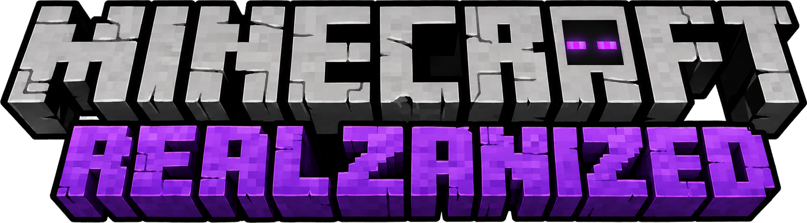

# Minecraft:realzanized



Minecraft:realzanized is a fan-made Minecraft you play in the browser: an endless survival world with six new biomes, new ores, a day and night cycle, shaders from a "Potato" mode for old computers up to **PEAK** shaders for fast ones, and multiplayer where everyone who types the same **Photon Realtime App ID** plays together. The Battle mini game (and Battle Royale) from the original project are still here under **Mini Games**. Single HTML file, WebGL, no install.

> Not affiliated with Mojang or Microsoft. All code and built-in art are original; Minecraft textures and sounds are only used if you load your own resource pack.

## What's in this version (stage 1: world + shaders)

**Play Game (Survival, endless world)**
- Worlds are generated as you walk, in 16x16 chunks, forever in every direction. Your changes are kept even when a chunk unloads, and each world is saved in the browser (every 30 seconds and when you leave). Pick a world from the list, or create one with a name and an optional seed.
- **Six new biomes**, plus ordinary Plains, Forest and Ocean between them:
  - **Sakura Forest**: pink sakura trees that glow softly, petals on the ground and falling through the air, sakura wood.
  - **Crystal Forest**: giant blue crystal spires, crystal clusters, cyan grass, and crystal caves underground lined with glowing crystals and crystal ore.
  - **Ancient Redwood**: massive 2x2 and 3x3 trees 25-40 blocks tall, thick fog, podzol and ferns, and old stone-brick ruins.
  - **Ashen Wasteland**: ash plains, volcanic mountains with lava craters, basalt and magma, burnt trees, and ash storms.
  - **Glowing Mushroom Fields**: giant glowing mushrooms, glowing plants and shrooms, glowing moss, floating spores.
  - **Frozen Forest**: frosted trees, snow, frozen lakes, ice spikes, and ice caves.
- **Caves** (long tunnels and big caverns, lava lakes near the bottom) and **ores**: coal, iron, gold, diamond and the new **Ruby** (more under Ashen Wasteland), **Sapphire** (Frozen Forest), **Cobalt**, **Mythril** (Crystal Forest, needs a diamond pickaxe) and **Amethyst Steel** (Mushroom Fields, needs a diamond pickaxe). Ores drop gems and raw metal.
- **Mining and building**: hold left click to mine (pickaxes for stone and ores, axes for wood; ores need a good enough pickaxe to drop anything), right click to place blocks. You start with stone tools, bread, torches and planks.
- **Day and night**: a 20-minute day with sunrise and sunset colours, a moon and stars. Torches, lava, crystals and glowing mushrooms light up the dark.
- Hunger, health, fall damage, drowning and lava as before. When you die you drop your items and can respawn at the world spawn.
- F3 shows coordinates, biome, light, time and chunk info.

**Crafting** (console style)
- Press **C** (or open the inventory with **E** and choose Crafting) for the console crafting screen: group tabs along the top (Structures, Tools and Weapons, Food, Armour, Materials, Decoration), a row of things you can make, the recipe picture with missing ingredients marked in red with **!**, your inventory on the right. On your own you get 2x2 recipes; right click a **Crafting Table** (4 planks) for everything.
- Click (or Space) crafts, Shift crafts as many as you can, A/D picks an item, W/S (or the mouse wheel) changes the material (wood, stone, iron, gold, diamond, ruby, amethyst steel, mythril), Q/R changes group, F shows a description.
- Recipes: planks from every wood, sticks, torches, chests, furnaces, slabs, fences, stone bricks, sandstone, storage blocks, pickaxes, shovels, axes and swords in eight materials, iron/gold/diamond/cobalt armour, bows (sticks and vines) and arrows (crystal shards and sticks), new foods (Sakura Mochi, Glow Stew, Crystal Candy) and the unique tools below. **Sapphire Enchanting** upgrades any tool or armour piece you carry (Efficiency, Sharpness, Protection up to III).
- **Furnace**: smelt raw iron, gold, cobalt and mythril into ingots, sand into glass, cobblestone into stone and logs into coal. **Chests** you place keep their items. The inventory screen (E) still lets you move stacks around with the mouse.
- **Ore abilities**: Ruby tools set what you hit on fire and smelt what they mine; Amethyst Steel heals you when you hit and digs 3x3; Mythril pickaxes mine a whole vein and Mythril axes fell a whole tree; a full Cobalt set stops knockback and halves fall damage. Tools wear out and show a durability bar.

**Unique tools**
| Tool | What it does |
| --- | --- |
| Grappling Hook | shoot it at a block and get pulled there (sneak to let go) |
| Builder's Wand | right click a block face to extend that surface by up to 9 blocks from your inventory |
| Item Magnet | hold it and dropped items within 10 blocks fly to you |
| Spyglass | hold right click to zoom |
| Compass / Clock | point back to spawn / show the day and time |
| Blink Staff | teleport up to 12 blocks where you look |
| Fire Staff | fire bolt that burns whatever it hits |
| Frost Wand | freezes water into ice and lava into obsidian around where you look |
| Sakura Staff | heals 3 hearts plus Regeneration (20 second cooldown) |
| Ore Scanner | shows every ore within 16 blocks through walls for 15 seconds |
| Mythril Glider | hold it and keep holding jump while falling to glide |

**Textures from the pack**: every new block and item (sakura, redwood and frozen wood, crystals, ash, basalt, magma, glowing mushrooms, the new ores and gem blocks, ruby/amethyst/mythril tools, cobalt armour, ingots, gems and all the unique tools) is made from the loaded resource pack's own textures, recoloured, so they match the pack's style. Without a pack they use built-in art.

**Saved games**: Play Game lists your saved games with a picture of each world, its day and when you last played. Save Game in the pause menu saves straight away (it also saves every 30 seconds and when you leave). Export downloads a world as a `.mcrworld` file you can keep or give to a friend, and Import Save loads one.

**Anti-cheat**: the developer-tools keys (F12, Ctrl+Shift+I/J/C, Ctrl+U) and right click are blocked. If the developer tools are opened anyway, or the game spots something that can't happen in play (too much health, impossible item stacks, moving impossibly fast), the page reloads straight away without saving, so nothing changed from the console is kept. The game's code is no longer reachable from the console window either. (Anything running in a browser can be got round by someone determined, so this stops casual cheating, not everything.)

**Graphics: Potato to PEAK** (Options > Video Settings > Graphics, or when creating a world)

| Preset | For | What you get |
| --- | --- | --- |
| Potato | old or slow computers, Chromebooks | half resolution, 3 chunks, flat lighting, fast leaves, no particles, 30 fps cap |
| Low | laptops | 75% resolution, 5 chunks, smooth lighting |
| High | most computers | full resolution, 8 chunks, waving leaves and plants, water waves with reflections and sun glints, sky with clouds, sunsets, stars |
| PEAK | fast computers | everything in High plus 12 chunks, real-time sun and moon shadows, bloom on glowing blocks, colour grading and vignette |

Render Distance can be changed separately (2-13 chunks). If the game runs slowly it suggests a lighter preset in chat. Biomes tint the fog and sky, and each has its own floating particles (petals, ash, snow, spores, sparkles).

**Multiplayer: servers, like Minecraft Java (carried by Photon)**
Multiplayer works like Java Edition's: you keep a list of servers, see who is online before you join, and one player's world is the server. Photon Realtime carries the connection, so nobody has to run a real server and it works from GitHub Pages too.

*One-time setup:* make a free account at [dashboard.photonengine.com](https://dashboard.photonengine.com), create a new application of type **Realtime**, copy its **App ID**, and paste it into **Multiplayer > Photon Settings** (pick your home region there too). Everyone who plays together uses the same App ID, so share it with your friends once.

*Hosting a server:*
- In a Survival world, open the pause menu and press **Open to Server** (like Open to LAN), or on the Multiplayer screen press **Host Server** and pick a world (or the Battle mini game).
- Choose the **server address** (for example `realz-castle`; outside the Americas region it gets the region on the end, like `realz-castle:eu`), the **Message of the Day**, **Max Players** (up to 20), the **game mode for other players**, **PvP** on/off, whether it's **listed publicly**, and an optional **whitelist**. The screen shows the exact address to give your friends.
- Your world is the server. Everyone's inventory, armour, position and game mode are saved in *your* world save, so players who come back get their things back. **Server Settings** in the pause menu changes the settings while it runs.
- When you leave (or type `/stop`), the server closes and everyone sees "Connection Lost: Server closed". With /stop you keep playing your world offline.

*Joining:*
- The **Multiplayer** screen lists your saved servers with their icon, name, MOTD, player count (hover it to see who's on) and ping bars, or "Can't connect to server" when nobody is hosting that address. Below them, **Servers online now** shows the public servers in your home region.
- **Join Server** (or double-click), **Direct Connection** (type an address once), **Add Server** / **Edit** (name and address), **Delete**, **Refresh**, and the arrows on a row reorder the list.
- If something goes wrong you get a Java-style message: "Failed to connect to the server: Unknown server", "The server is full", "You are banned from this server", "You are not white-listed on this server!", "Disconnected: Kicked by an operator", and so on.
- In game, hold **Tab** for the player list (server MOTD, everyone's ping, the address), and the pause menu has **Disconnect**.

*Server commands* (T or / for chat). They run on the host. The host is always an operator and can `/op` other players.
| Everyone | Operators |
| --- | --- |
| `/help`, `/list`, `/msg <player> <message>` (also `/tell`, `/w`), `/me <action>` | `/kick <player> [reason]`, `/ban <player> [reason]`, `/pardon <player>`, `/banlist`, `/op` / `/deop <player>`, `/whitelist on\|off\|add\|remove\|list`, `/gamemode <survival\|creative> [player]`, `/defaultgamemode <mode>`, `/tp <player>`, `/tp <player> <player>`, `/tp [player] <x> <y> <z>` (`~` for relative), `/time set\|add\|query`, `/say <message>`, `/seed`, `/stop` (host only) |

In single player every command works, as in a world with cheats on. A player who joins with the same name as someone already on the server replaces the old session ("You logged in from another location"); operators can always join, even with the whitelist on. Names are not accounts, so bans and the whitelist go by player name. A Photon free plan allows 20 players online at once across all servers using that App ID.

**Mobs**
Animals and monsters now live in the Survival world. They use the resource pack's own entity textures (the new ones are the vanilla skins recoloured) and the real 1.8 model shapes and walking animations.

| Mob | Where | What it does | Drops |
| --- | --- | --- | --- |
| Pig, Cow, Sheep, Chicken | Plains and Forests | Wander, run when hit. Shear sheep (wool regrows), milk cows with a bucket, dye sheep any colour. Chickens lay eggs | Pork, beef, leather, mutton, wool, chicken, feathers |
| Deer | Sakura, Crystal, Redwood, Frozen | Shy: bolts when you get close unless you sneak | Venison, leather |
| Glowshroom | Glowing Mushroom Fields | A glowing mushroom cow. Shear it for Glow Shrooms | Glow Spores |
| Ice Wolf | Frozen Forest | Neutral: the pack attacks if you hit one. Tame one with bones: it follows you, fights for you, wears a red collar and is saved with the world | Frost Fangs |
| Zombie, Skeleton, Spider, Creeper | Anywhere dark: caves and at night | Zombies and skeletons burn in daylight, skeletons shoot arrows and keep their distance, spiders climb walls (only hostile in the dark), creepers hiss and blow up blocks | Rotten flesh, bones, arrows, string, spider eyes, gunpowder |
| Crystal Spider | Crystal Forest caves and nights | A glowing spider whose bite slows you | Crystal Silk, Crystal Shards |
| Magma Creature | Ashen Wasteland, day or night | Hops at you and sets you on fire. Immune to fire and lava | Magma Cream |

Animals killed while burning drop cooked meat. **Options > Survival Difficulty** sets Peaceful (no monsters), Easy, Normal or Hard (monster damage). In multiplayer the host runs every mob and everyone sees the same ones.

**100+ new things**
- **50 blocks**: TNT (light it with Flint and Steel; explosions chain), wool in all 16 colours, Bookshelf, Hay Bale, Pumpkin and Jack o'Lantern (pumpkins and melons grow wild in Plains and Forests), Melon, Clay (lake and ocean floors) and Terracotta, Blocks of Iron and Lapis, Nether Bricks, End Stone, Prismarine, Prismarine Bricks, Dark Prismarine, Sea Lantern, Jukebox, Note Block, Redstone Lamp, Crystal / Basalt / Ash / Ice / Snow / Magma Bricks, Sakura Lantern, Glowshroom Lamp, Mythril Lantern, Quartz Pillar, Chiseled Quartz, and Granite, Diorite and Andesite (now found underground) plus their polished forms.
- **20 mob drops**: raw beef, porkchop, chicken, mutton and venison, cooked mutton and venison, leather, feathers, rotten flesh, bones, bone meal (grows flowers and grass), string, gunpowder, spider eyes, magma cream, eggs (throw them: sometimes a chick hatches), frost fangs, crystal silk, glow spores.
- **14 dyes** made from flowers, gems, coal, petals and crystals, which colour wool and sheep.
- **9 foods**: Golden Carrot, Fried Egg, Frost Berries (Frozen leaves), Ember Pepper (Ashen dead bushes, fire resistance), Crystal Apple (absorption and speed), Spore Bread, Magma Jerky, Venison Stew, Milk (clears effects).
- **Tools and weapons**: Flint and Steel (flint comes from gravel), Shears, Bucket, Crystal Bow (three arrows a shot), Frost Dagger (slows), Magma Hammer (shockwave that burns everything near the target), Spore Bomb and Frost Bomb (throwable), Mob Radar (shows creatures within 32 blocks), Totem of Renewal (saves you from one death), and craftable leather armour. Bows can be made with string, arrows with flint and feathers.
- Every new recipe is on the console crafting screen's tabs, and raw meat, eggs, clay, rotten flesh, grass and gravel can go in the furnace.

**Creative mode**
Pick **Game Mode: Creative** when you create a world (or switch any time with the **Game Mode** button in the pause menu, or type `/gamemode creative` / `/gamemode survival` in chat with T or /; on a server you need to be an operator).
- **E** opens the Creative menu: tabs for Building Blocks, Decoration, Natural Blocks, Tools and Gadgets, Combat, Food and Potions, Materials, and a Search tab, plus a tab back to your normal inventory for armour. Click takes a full stack, right click takes one, shift-click drops it straight into your inventory, hover and press 1-9 to put it in that hotbar slot, and the red Destroy Item slot deletes what you're holding (shift-click it to clear your inventory).
- **Double-tap jump to fly** (Space; on touch screens and controllers double-tap the jump button). Jump goes up, sneak goes down, sprint flies faster, and landing while sneaking stops flying.
- Blocks break instantly and drop nothing; placed blocks, food, arrows and throwables never run out; tools never wear out; bows shoot without arrows.
- No damage and no hunger (only the void can hurt you), and monsters ignore you.
- **Middle click** picks the block you're looking at into your hand.
- Your game mode is saved with your player in the world. On a server, players join in the server's "game mode for other players", and operators can switch anyone's mode with `/gamemode`. `/time set day|noon|night|midnight` changes the time.

**Locator bar (multiplayer)**
Like Java 1.21.6: in a Survival game with other players, the bar above the hotbar shows a coloured dot for each player in the direction they are from where you are looking. Dots shrink with distance, show an arrow when someone is well above or below you, and pin to the ends with an arrow when they are behind you. Look straight at a dot to see that player's name and distance.

**Mini Games**: Battle, Battle Royale, Tumble, Glide, Play Online (Battle Servers on Photon, see below) and Practice. Every game opens the Create / Join / Friends screen below. The Tumble arena and the Glide courses are this game's own designs.

**Java combat (Battle and Battle Royale)**: fights use Java Edition's 1.9+ combat. Survival, Tumble and Glide keep the console-style 1.8 combat.
- **Attack cooldown:** each weapon recharges at its own speed: swords 1.6 swings a second, axes 0.8 to 1.0, pickaxes 1.2, fists 4. A bar under the crosshair fills as you recharge and turns into a small sword when you're charged and aiming at someone. Damage runs from 20% to 100% with the charge, so spam-clicking barely hurts. Swinging at the air or switching items restarts the cooldown.
- **Damage:** the Java 1.9+ values: swords 4/5/6/7 (wood/stone/iron/diamond; gold 4), axes 7/9/9/9 (gold 7). Sharpness adds 0.5 per level + 0.5. Strength adds 3 per level; Weakness takes off 4.
- **Charged hits:** a charged hit while falling is a critical (×1.5), but not while sprinting. A charged hit while sprinting knocks back further. A charged sword hit while standing or walking sweeps: 1 damage and a push to anyone right beside the target.
- **Shields:** swords no longer block; shields do. They're found in chests. Press **F** to swap the item in your hand with your off hand (the slot left of the hotbar), then hold right-click to raise it. A raised shield stops melee hits and arrows from the front and pushes melee attackers back. An axe hit knocks it down for 5 seconds. Shields wear out. Bots use shields too.

**Tumble**: everyone starts on the top of three floating layers of patterned blocks over a lava lake.
- **Tools** (a create option): **Snowballs** break the block they hit, push players back and set off the TNT hidden in the lower layers. **Shovels** break a block instantly, but only up close. **Both** gives everyone one of each (mouse wheel or LB/RB to switch).
- Fall into the lava and you're out for the round. The last player standing wins it.
- After two minutes the layers start crumbling away, faster and faster, so every round ends.
- A game is 3, 5 or 7 rounds (**Rounds** option), each on freshly generated layers. The bars along the bottom show each round: green you won, red someone else did. The most round wins takes the game.
- No damage or hunger, just the lava. Bots play Tumble offline.

**Glide**: fly an elytra round a looping course. There are three courses, **Canyon Run**, **Sandstone Spires** and **Magma Rift**, and races are 1 to 3 laps.
- Steer by looking. Dive for speed, pull up to climb, and hold R (Y on a controller) to look behind you. The flight follows vanilla elytra physics, including the smaller 0.6-block hitbox.
- **Green rings** score a point each, once per lap. **Golden rings** are checkpoints (2 points); pass all four to finish a lap. **Updrafts** (yellow sparkles) at the end of each lap carry you back up to the top.
- Crash into the walls three times, land, or stall, and you go back to your last checkpoint.
- **Score Attack**: the most points wins. Finishing 1st, 2nd or 3rd adds 20, 15 or 10, and anyone else who finishes gets 5.
- **Time Attack**: the fastest time wins, and your best time on each course and lap count is kept.
- Once the first player finishes, everyone else has 30 seconds to reach the end.
- HUD: standings on the left; time, speed and score on the right; a progress bar with everyone's position, the lap counter and your three hearts at the bottom.

**Create / Join / Friends**: each mini game opens a screen with three tabs (switch with left/right, Q/E, Tab or LB/RB):
- **Create**: pick Battle, Battle Royale, Tumble or Glide, then its create options. Tumble adds **Tools** and **Rounds**; Glide has **Course** and **Laps**, then **Create Score Attack** or **Create Time Attack**. Online Game, Public Game, Invite Only and Server Settings work as for Battle.
- **Join**: pick a game and what you want (Battle: **Round Length**; Tumble: **Tools**; Glide: **Course**), then **Join Casual** / **Join Competitive** (Glide: **Join Score Attack** / **Join Time Attack**). It searches the public games in your Photon region and puts you in the best match, preferring games still in the lobby, then the busiest. If a round is already going you join as a spectator.
- **Friends**: public Battle games that players you've played with before are in. Photon has no friends lists, so the game remembers the last 100 players you were online with.

**Creating a Battle game**: picking a game on the Create tab opens the create options. On the left are tick boxes and buttons; on the right, a description of whatever is selected:
- **Central Spawn**: everyone starts around the middle of the arena (Battle only).
- **Online Game**: makes the game a Photon server others join by address. Untick it to play offline against bots.
- **Public Game**: lists the server in Battle servers online now.
- **Allow friends of friends**: always greyed out, because Photon has no friends lists.
- **Invite Only**: only the players named in Server Settings can join.
- **Select Maps**: choose which maps the game goes through.
- **Server Settings**: the address, region, MOTD, player limit and invite list.
- **Round Length**: Short, Normal or Long.
- **Create Casual**: everyone keeps their skin, and spectators are bats.
- **Create Competitive**: skins with see-through body parts are swapped for plain ones, and spectating bats are invisible and silent to the players still fighting.

Click the Battle title, or press left or right on it, to switch to Battle Royale.

### Controls

| Key | Action |
| --- | --- |
| WASD | Move |
| Space | Jump / swim up / climb |
| Shift | Sneak |
| Ctrl or double-tap W | Sprint |
| Left click | Attack; hold to mine (Survival and Battle Royale) |
| Right click | Place block, eat/drink/draw bow (hold), open chest, throw splash potion, block with sword, equip armour |
| 1-9 / wheel | Hotbar |
| E | Inventory (move stacks with the mouse) |
| C | Crafting (Survival) |
| Q | Drop item |
| F3 | Debug screen |
| Esc | Pause (Leave Game saves your world) |

**Mobile controls** (pocket-edition style): a square stick bottom-left (it moves to where your thumb lands; push past the top of the frame to sprint), and pixel-art buttons on the right: jump, sneak and use in a column, with sprint and attack beside them. Tap sneak or sprint to toggle them, or hold them. While flying, jump and sneak go up and down. Small buttons at the top: drop (hold to drop the whole stack), inventory, pause, and chat when online. Drag the right side to look, tap the world to hit, hold still to use. Options > Controls has Touch Look Speed, Button Size, Button Opacity and Vibration.

## Beating the game: the Nether, the End and the Ender Dragon

Survival now has a full journey from the first night to the credits.

**A more natural Overworld (new worlds)**
- New worlds use a rebuilt terrain generator: continents and oceans, long **mountain ranges** with stone cliffs and **snow-capped peaks**, rolling hills, and **rivers** winding through their own valleys to the sea. The world is 160 blocks tall to fit the mountains.
- Biomes are placed by temperature and rainfall, so cold, temperate and hot places sit next to each other the way they should, and every border is blended. The six custom biomes are all still there, mixed in with new vanilla ones: **Birch Forest**, **Taiga** (spruce and pine), **Savanna** (acacia), **Desert** (cactus, dead bushes), **Dark Forest** (2x2 dark oaks, mushrooms), **Windswept Hills** and **Rivers**.
- More plant life: tall grass, ferns and large ferns, eight new flowers and the two-block lilac, rose bush and peony, red and brown mushrooms, sugar cane on river banks, pumpkins, boulders, fallen logs, ponds and lava pools, cave mouths, and **ruined portals** with a chest of loot.
- Worlds saved before this update keep their old terrain (and get strongholds too), so nothing you built moves.

**Water, lava and fire**
- Water and lava now **flow**: water spreads 7 blocks and falls, lava spreads 3 (7 in the Nether), two sources make an infinite water source, and when they meet you get **obsidian** (from still lava) or **cobblestone**. Buckets pick up and pour both. Water boils away in the Nether.
- Fire spreads to wood, leaves and wool and burns out (forever on netherrack); rain puts it out.

**The Nether**
- Build an **obsidian frame** (at least 4 wide and 5 tall, corners optional, up to 23x23) and light it with **Flint and Steel**. Stand in the purple swirl for 4 seconds. Portals link like the game: 1 block in the Nether is 8 in the Overworld, and an existing portal nearby is used, otherwise a new one is built for you.
- The Nether: huge caverns, a lava sea, soul sand, gravel, magma, glowstone, nether quartz ore, fire, mushrooms and nether wart.
- **Nether Fortresses**: nether brick bridges on tall arches, **blaze spawners**, a nether wart garden and treasure rooms.
- New creatures: **Zombie Pigmen** (neutral; hit one and they all come for you), **Ghasts** (their fireballs explode; punch one back), **Blazes** (fireballs, drop **Blaze Rods**), **Wither Skeletons**, and Magma Creatures.

**Strongholds and the End**
- **Endermen** roam at night (don't look them in the eye) and drop **Ender Pearls**. Throw a pearl to teleport. Blaze Rod -> 2 Blaze Powder; Blaze Powder + Ender Pearl -> **Eye of Ender**.
- Throw an Eye of Ender and follow it: it flies toward one of the three **strongholds** hidden deep underground 640-1150 blocks from the middle of the world. The portal room has 12 **End Portal Frames** over a pool of lava; fill them all with eyes to open the **End Portal**.
- **The End**: a dark floating island of end stone, ten obsidian pillars with **End Crystals** (two in iron cages), endermen everywhere, and the **Ender Dragon** (200 health, boss bar). It circles, strafes you with breath, charges, and lands on the exit portal to breathe acid. Crystals heal it: break them first (arrows work). Beds explode outside the Overworld...
- When the dragon dies the **exit portal** opens and the **Dragon Egg** appears. Jump in for the ending (our own words), then you are back home. The fight stays won in your save.

**Feeling more like the game**
- **Experience**: orbs from creatures and ores, a level bar above the hotbar, and the classic level-up sound.
- **Weather**: rain (snow in cold places and high up), dark thunderstorms with lightning that can start fires, and rain sounds.
- **Beds**: sleep through the night and set where you respawn.
- Ambient sounds in caves, underwater, the Nether and the End; lava pops and crackling fire; portal hums; the Nether's red haze and the End's dim sky.
- The vanilla blocks above use the resource pack's own textures only. **No existing texture or block design was changed.**

Multiplayer: everyone can be in a different dimension. Players only see the people in the same dimension as them, block changes and portals are shared, and creatures and dropped items in a dimension the host isn't in run on the computer of the player who is there.

## The Battle mini game


Open `index.html` in a browser, or host it with GitHub Pages (below).

- **Play Game**: Battle vs bots on Temple, Cavern, Cove, Crucible or Skyhold
- **Temple** (new): a ruined stone-brick temple deep in a jungle cave, after the Battle key art: centre chests inside the temple and in the shrine on top (ladder inside), a lily-pad moat you can cross by bridge, stepping stones or the lily pads themselves, a jungle floor with ruins and trees, and a gallery round the cave wall
- **Bots that play like players**: they keep a sensible inventory, loot, then go hunting (with route-finding over stairs, ladders and drops), shoot with bows at people they can't reach, and give up on anything they can't get to instead of standing still
- **Play Online** (in Mini Games): Battle Servers on Photon, the same server system as Survival multiplayer
- **Enchanted items**: Sharpness, Knockback and Fire Aspect swords and axes; Power, Punch, Flame and Infinity bows; Protection armour. They show a purple glint, list their enchantments in the inventory tooltip, and turn up in chests (more often in the centre ones). Turn them off with **Enchanted Loot** in Game Rules.
- **Console look and feel** (matched to Xbox One Edition Battle footage): raised console HUD with the 8-slot player colour strip, a small animated model of you on the left, kill messages in the chat area, contextual button prompts, "Invulnerability wears off / has worn off! Fight!" messages, rounds that start behind a "Downloading terrain" loading screen with tips, block info panels when you look at a block, and an end-of-round scoreboard with kills, awards, favourite weapon, damage inflicted/received and round time. In-Game Tooltips and Animated Character can be turned off in Video Settings.
- **Practice**: lobby town with a movement playground (ice, slime, soul sand, cobwebs, ladders, slabs, stairs, water)
- **Help & Options**: name, skin, round length, hunger rate, item respawn, grace period, Showdown, Take Everything, central spawn, bots, maps, Battle Royale settings


## Host on GitHub Pages

1. Push this folder to a GitHub repository.
2. In the repo: **Settings > Pages > Build and deployment**, set **Source** to *Deploy from a branch*, branch `main`, folder `/ (root)`.
3. After a minute the game is live at `https://<your-username>.github.io/<repo-name>/`.

### Online multiplayer for the Battle mini game (Photon servers)

Battle uses the same Photon server system as Survival (see Multiplayer above), with the same Photon App ID.

- **Mini Games → Play Online** opens **Battle Servers**: your saved Battle servers (a separate list from the Multiplayer screen) and **Battle servers online now**, the public Battle and Battle Royale servers in your home region. Each row shows the address, the mode, the next or current map, whether it is in the lobby or mid-round, the MOTD, players and ping. Join Server, Direct Connection, Add / Edit / Delete and Refresh work as on the Multiplayer screen.
- **Host Server** opens the Battle create screen (above) with Online Game ticked: pick the address (`name` or `name:region`), MOTD, max players (up to 20), public listing and an invite list, then Create Casual or Create Competitive. Competitive servers say so in the list. You are the host: you run the bots, chests and round timer, and you set the game rules from the lobby. Battle servers can also be hosted from Multiplayer → Host Server.
- The host's commands work here too (`/kick`, `/ban`, `/pardon`, `/op`, `/whitelist`, `/list`, `/msg`, `/say`, `/time`, `/stop`); the pause menu has **Server Settings** while you host.
- **When the host leaves:** quitting closes the server for everyone ("Server closed"). If the host's connection drops instead, the round carries on: the next player becomes the host (bots included) and the server keeps its address and listing. The bans and whitelist stay with the old host.
- If you're not the host, taking from chests, picking items up and dropping them happen instantly on your screen; the host checks each move and takes an item back only if someone else got it first. After a round everyone goes back to the lobby.

`server/server.js` (`node server/server.js`, or `npm start`) still serves the game files on your network if you'd rather not use GitHub Pages; online play itself goes through Photon.

### Resource packs

Players can load any Java Edition resource pack (`.zip`) or a client `.jar` they own from **Resource Packs**. Packs are kept in that browser only. Both 1.8 and modern file names are supported, including `sounds.json` sound events.

**Java keys:** F5 cycles first person / third person behind / in front, F1 hides the GUI, F3 shows the debug screen, T (or /) opens chat in multiplayer.

**Mouse:** some Mac browsers report mouse movement too big while a button is held, which made the camera turn faster whenever you clicked. Mac Click Fix (Controls, Auto = on for Macs) undoes it: it learns how much the browser inflates movement from how fast you move just before and after each click, and divides it back out. Controls > Raw Mouse Input picks between raw input (no OS acceleration) and normal input; Auto uses normal input on Macs.

**Connection:** the Tab lobby panel and the F3 screen show your ping and which server you are on, and you get a warning in chat if it stays above 250 ms. Lag comes mostly from distance: host in the Photon region closest to your players.

**Options & mobile:** Help & Options opens Java-style Options screens (Video Settings, Music & Sounds, Controls, Game Rules, Maps). Mobile Controls (Auto/ON/OFF) adds a touch joystick, drag-to-look, tap-to-attack, hold-to-use and buttons for jump, sneak, sprint, inventory and drop. Settings are saved in the browser.

**Default packs:** `pack.zip` (Template Resource Pack 1.8) and `sounds.zip` (Enhanced Audio r7) sit beside `index.html` and load automatically when the page is hosted (GitHub Pages, or any local web server). Browsers block this when you double-click `index.html` from disk, so either host it or load the packs once from the Texture Packs menu.

**Dressing Room:** the player preview beside the title menu opens the Dressing Room, where you can set your name and import your own skin (64x64 or legacy 64x32 PNG). Imported skins are saved in your browser and sent to other players in online games.

**Title logo:** `logo.png` beside `index.html` is the Minecraft:realzanized title logo (loaded automatically when hosted; if the page is opened straight from disk a drawn version is used instead). Mini Games shows `logo_battle.png`. Replace `logo.png`, or pick an image under Texture Packs → Title logo image, to use your own.

## Editing the code

The game lives in `src/` (numbered JavaScript files plus `shell.html`); `vendor/photon-realtime.js` is the Photon Realtime JavaScript SDK (browser build). After editing, rebuild the single file:

```
python3 build.py
```

| File | What it does |
| --- | --- |
| `01_core.js` | Math, noise, zip reader |
| `02_blocks.js` | Blocks, shapes, procedural textures |
| `02b_biomeblocks.js` | New biome blocks and ores, and their textures |
| `03_items.js` | Items, 1.8 stats, loot tables, icons |
| `03b_survitems.js` | Gems and raw metals, mining speeds, what each block drops |
| `04_world.js` | Battle maps, lobby town, Battle Royale, lighting |
| `04b_maps.js` | Cove, Crucible and Temple |
| `04c_inf.js` | Endless world: chunk ring buffer, biomes, terrain, caves, ores, trees and structures, chunk lighting, streaming |
| `05_gl.js` | WebGL, compact chunk meshes, models, item meshes |
| `06_pack.js` | Resource pack loader |
| `07_game.js` | Entities, combat, hunger, effects, projectiles, drops |
| `07b_mcphys.js` | Java Edition movement physics (20 TPS) |
| `08_net.js` | Multiplayer core (host rules, host hand-over); the old relay clients, no longer used by the menus |
| `08b_photon.js` | Photon Realtime transport: servers by address, the lobby list for the server browser, error messages |
| `09_flow.js` | Match flow, lobby, chests, MCBR timeline, net events |
| `10_bots.js` | Bot AI, including route-finding |
| `11_render.js` | Audio and rendering |
| `11b_gfx.js` | Graphics presets, world/sky/water shaders, shadows, bloom, day/night, ambient particles |
| `12_hud.js` | HUD |
| `13_ui.js` | Menus, input, local player |
| `14_main.js` | Main loop |
| `15_survival.js` | Survival: worlds and saving, loading, death and respawn |
| `06b_derive.js` | New block and item textures made from the resource pack's own art |
| `15b_craft.js` | Recipes, inventory screen, furnace, placed chests, tool abilities, durability, Survival name tags |
| `15c_lcecraft.js` | Console-style crafting screen |
| `15d_gadgets.js` | The unique tools |
| `02c_moreblocks.js` | TNT, wool colours, lanterns, biome bricks, stone types and the other new blocks |
| `03c_moreitems.js` | Mob drops, dyes, new foods, tools and weapons |
| `06c_derive2.js` | Textures for the new blocks and items, mob skins from the pack |
| `15bz_morerecipes.js` | Recipes and smelting for the new things |
| `15cz_tabs.js` | The new recipes on the crafting screen tabs |
| `15e_mobs.js` | Mobs: models, AI, spawning, multiplayer sync, explosions and TNT, mob radar |
| `15f_locator.js` | Multiplayer locator bar |
| `15g_creative.js` | Creative mode: item menu, flying, instant breaking, pick block |
| `15h_servers.js` | Servers: the Multiplayer and Battle Servers screens, hosting, joining, bans/whitelist/kicks, saved player data, Tab player list |
| `15i_commands.js` | Chat commands, run on the server host with operator permissions |
| `15l_combat.js` | Java 1.9+ combat for Battle and Battle Royale: attack cooldown, damage, crits, sweeps, shields, the off hand |
| `15k_minigames.js` | Tumble and Glide: arena and course generation, rules, rounds, elytra flight, bots, HUD and results |
| `15j_battlecreate.js` | The Battle create screen (Casual / Competitive) and the Competitive rules; its picture is `battle_art.jpg` |
| `02d_vanilla.js` | Vanilla blocks: birch/acacia/dark oak/spruce leaves, plants and flowers, flowing water and lava levels, nether and End blocks, portals, beds |
| `03d_vanillaitems.js` | Ender pearls and eyes, blaze rods, buckets of water and lava, nether items; mining times and drops for the new blocks |
| `04d_terrain.js` | Terrain v2: continents, mountains, rivers, climate biomes, new trees and plants, ruined portals, strongholds, loot chests |
| `04e_dims.js` | Nether and End generators, Nether Fortresses, the End island, pillars and exit portal |
| `06d_vanillapack.js` | Foliage tints and derived tiles (turned bed tops, End portal) from the resource pack |
| `15bw_vanilla.js` | Recipes, fuel and smelting for the vanilla things |
| `15m_dims.js` | Dimensions: travel, saving all three, Nether and End portals, flowing liquids, fire, buckets, beds, pearls, eyes, multiplayer |
| `15n_mobs2.js` | Nether and End creatures, spawners, fireballs, the Ender Dragon fight, End Crystals, boss bar |
| `15o_atmos.js` | Experience, weather and lightning, ambient sounds, the ending, menu entries |
| `16_guard.js` | Anti-cheat |

## Coming next

Structures (Lost Civilization, Sky Castle, Overgrown Temple, Forgotten Village, mushroom villages, villages), the bosses (Ancient Golem, Frost Dragon, Magma Titan), saplings and farming, and the End cities.

## Credits

- Battle Royale rules and the Easter-head structure follow the MinecraftBattleRoyale datapack by Zakru.
- Inspired by Minecraft: Legacy Console Edition Battle by 4J Studios / Mojang.
